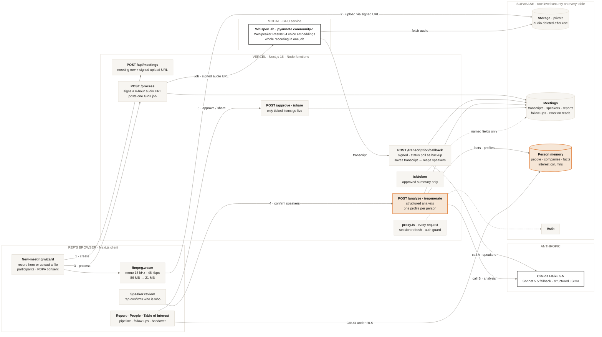

# Lepaq — Meeting Intelligence CRM

*Every coffee chat, remembered.* Private AI memory for B2B relationship
builders.

Upload a meeting recording, get back a report you can send, follow-ups you
actually keep, and a relationship record for everyone in the room.

Built from `MVP_BUILD_SPEC.md`. Everything the AI produces is a **private
draft** until the user approves it — that stance shapes the data model and the
UI, and it is not decoration.

---

## Quick start

```bash
npm install
cp .env.example .env.local   # then fill it in, see below
npm run dev
```

The app will not do anything useful until Supabase is set up.

### 1. Supabase

1. Create a project at [supabase.com](https://supabase.com).
2. Open the SQL editor and run every file in `supabase/migrations`, in
   order, each in full:
   - `0001_init.sql` creates the base tables, all row level security
     policies, the private `meeting-audio` storage bucket with its policies,
     and the trigger that gives each new user the default status lists;
   - `0002` and `0003` stop duplicate people and companies, and add the
     person-fact categories and the user's own Table of Interest columns;
   - `0004` and `0005` add the speaker embeddings and the GPU job table that
     transcription writes to.

   Each is safe to re-run. `npm run preflight` checks that every table is
   there, and names the file to run from if one is missing.
3. Copy Project Settings → API into `.env.local`:
   - `NEXT_PUBLIC_SUPABASE_URL`
   - `NEXT_PUBLIC_SUPABASE_ANON_KEY`
   - `SUPABASE_SERVICE_ROLE_KEY` — server only, never `NEXT_PUBLIC`

### 2. Claude

Add `ANTHROPIC_API_KEY`. Speaker mapping and the meeting report are both
structured-output calls to Claude (`lib/ai/respond.ts`):

| Variable | Default | Notes |
|---|---|---|
| `LLM_MODEL` | `claude-haiku-5-5` | Answers every call first. |
| `LLM_FALLBACK_MODEL` | `claude-sonnet-5-5` | Asked only when the first model refuses, runs out of tokens, returns JSON that fails validation, or is rate limited / overloaded after the SDK's retries. Never on a 400. |
| `LLM_EFFORT` | `medium` | `low` to `max`. Raise if coach output reads thin. |

The report stores which model actually answered (`meeting_reports.model`).
The system prompts are cached; no `temperature` or prefill is sent (both are
rejected by these models).

Transcription is separate: see **Whole-file jobs on the GPU service** below.

### 3. Signing in during development

If the owner account has no password set, or you would rather not type one
thirty times a day, put this in `.env.local`:

```
DEV_AUTH_BYPASS=true
OWNER_EMAIL=you@example.com
```

The login page then offers **Sign in without a password**, which mints a real
Supabase session through the admin API and writes the normal session cookie.
RLS, the proxy guard and every route behave exactly as they do for a real
user — it is a shortcut past typing a password, not past authentication.

It cannot reach production. The route, the button and the proxy exemption all
require `NODE_ENV !== "production"`, which `next build` sets. Verified against
a production build with `DEV_AUTH_BYPASS=true` still set: the button is absent
from the page, an anonymous request is bounced to `/login`, and an
*authenticated* request — where the proxy does let it through — gets a 404
from the route itself.

### 4. Demo data

```bash
npm run seed
```

Creates `sarah@rapport.demo` / `rapport-demo-123` with 8 companies, 14 people,
5 meetings, 9 follow-ups and the saved facts the demo script leans on. One
meeting is deliberately left in `review` so the dashboard inbox is not empty.

---

## Architecture

Five parts: the rep's browser, Next.js functions on Vercel, the GPU service
on Modal, Claude, and Supabase. Numbered edges are the user's path through a
meeting; orange marks where the value compounds — the analysis step and the
per-person memory it writes.



A static copy is in [`docs/architecture.png`](docs/architecture.png) for
viewers that do not render Mermaid. Regenerate it from the block above (for
example at mermaid.live) when the diagram changes.

---

## How a meeting flows through the system

```
browser                          server                        storage / GPU / Claude
───────                          ──────                        ──────────────────────
POST /api/meetings ───────────►  create rows, sign upload URL
upload file ──────────────────────────────────────────────►    Supabase Storage
POST .../process ─────────────►  sign audio URL, post job ───► GPU service on Modal
                   ◄───────────  status: transcribing          (fetches the audio itself)
                                 callback or status poll ◄───  transcript, voice embeddings
                                 propose speakers ───────────► Claude (call A)
GET .../status     ◄───────────  status: awaiting_speakers
user confirms speakers
POST .../analyze ─────────────►  rewrite labels, analyse ────► Claude (call B)
                   ◄───────────  status: review
user approves ────────────────►  status: ready
```

States: `uploaded → transcribing → awaiting_speakers → analyzing → review →
ready`, plus `failed` with an error message and a Retry button.

`review` means AI output exists but nobody has approved it. Anything
unapproved wears a **Draft** badge.

---

## Long recordings

The spec capped uploads at 25MB and put chunking on the roadmap. The cap here
is the Supabase object limit (50MB) instead. The GPU service takes the whole
recording in one job, so length only matters to the browser upload and to the
per-part backend (`TRANSCRIBE_BACKEND=whisperlah`), which splits server-side.

For the per-part backend, two different ceilings drive the decision, and
conflating them is how this goes wrong:

- **Size** — each request stays under 20MB (`CHUNK_TARGET_BYTES`). Re-encoding
  to mono 16kHz 48kbps MP3 costs about 6KB/s, so an hour of speech is roughly
  21MB. Compression alone rescues most real meetings.
- **Time** — a Vercel function dies at 300s. A single 90-minute transcription
  request can outlive that even though the file would have fitted. So audio
  past 25 minutes is split and the parts run concurrently.

**Before any of that, the browser shrinks the file.** A 90-minute recording
off a phone is 120-130MB and the Supabase free tier refuses a storage object
over 50MB, so `lib/audio/compress-client.ts` re-encodes it to mono 16kHz
48kbps MP3 with ffmpeg.wasm before it is uploaded. Measured on the real
61-minute test recording: **86.3MB down to 21.0MB, 76% smaller**, about 60
seconds of encoding plus a one-off 32MB core download on first use. That is
the same encode that already produced 1022 diarized segments and a clean
analysis, so nothing is lost by it.

The core is served from `/public/ffmpeg` (copied out of node_modules by
postinstall, gitignored) rather than a CDN, and the single-threaded build is
used deliberately so no COOP/COEP headers are needed. If it cannot load for
any reason, the original file is uploaded instead and the old size limit
applies — compression is an optimisation, never a gate.

Server-side, on the per-part backend, `lib/audio/chunk.ts` then picks one of
three paths:

1. short and small — send the original bytes, ffmpeg never runs;
2. oversized but under 25 minutes — one re-encoded MP3, still one request;
3. longer — split into parts (default 10 min), transcribed 3 at a time.

**Speaker labels are per-request.** Chunk 2's "Speaker A" is not chunk 1's
"Speaker A". Rather than matching voices acoustically, labels are namespaced
(`c0_A`, `c1_B`) and the existing speaker-mapping step reconciles them across
parts — reusing the Speaker Review screen as the safety net instead of
inventing a fragile new one. Several labels collapsing onto one participant is
the normal result.

**Resumability.** Each part's transcript is stored on its
`transcription_chunks` row as it lands. If the function runs out of time,
`/process` returns `{complete: false}` and the client calls it again; the next
invocation skips the parts already done. That is what makes a 90-minute
recording finish without a queue or a background worker.

```bash
npm run check:audio   # verifies all three paths against generated audio
```

### Self-hosted transcription (test branch)

`TRANSCRIBE_BACKEND=whisperlah` sends the recording part by part to our own
server, `singlish-asr/scripts/serve/server.py`:

| Job | Model |
|---|---|
| Words | WhisperLah v2 (Whisper large-v3-turbo + our Singlish adapter, CTranslate2 int8) |
| Who spoke when | pyannote `speaker-diarization-community-1` |
| Voice embedding | pyannote's built-in WeSpeaker ResNet34, 256-dim, not fine-tuned |

The server returns `{speaker, start, end, text}` segments for each part;
`/process` stores them per part, resumes and stitches them as described above,
and speaker mapping and review work as on the jobs backend. It also returns
one voice embedding per speaker label; those are kept on the chunk row while
it is in flight and then written to `speaker_embeddings` with the model name
(migration `0004`). Nothing reads them yet: they are there to test matching
the same voice across parts and across meetings.

To try it locally: start the server on the GPU machine, apply
`0004_speaker_embeddings.sql`, then in `.env.local`

```
TRANSCRIBE_BACKEND=whisperlah
WHISPERLAH_URL=http://127.0.0.1:8765
WHISPERLAH_MODE=room
```

Vercel cannot reach `127.0.0.1`, so a deployed build needs the server behind
a public URL with `WHISPERLAH_TOKEN` set. The model weights stay on the
serving machine and are never committed.

### Whole-file jobs on the GPU service

`TRANSCRIBE_BACKEND=jobs` is the default and the deployed shape of the same
stack, served from Modal. Three settings, all set in Vercel:

| Variable | What it is |
|---|---|
| `WHISPERLAH_URL` | base URL of the Modal app; `/jobs` and `/jobs/{id}` are appended |
| `WHISPERLAH_TOKEN` | bearer token the service expects on both |
| `CALLBACK_SECRET` | shared secret the service signs its callbacks with |

`/process` no longer downloads or splits anything: it signs a 6-hour URL for
the audio, records a row in `transcription_jobs` (migration `0005`), posts
`{job_id, audio_url, callback_url, mode, num_speakers}` to
`{WHISPERLAH_URL}/jobs`, and returns. The service transcribes the whole
recording in one request, so speaker A is the same person all meeting and the
300 s function limit no longer applies, then POSTs the result to
`/api/transcription/callback`.

- The GPU scales to zero when idle, so the first job after a quiet spell
  waits for one to start. Measured on Modal's L4 with a 17.5-minute meeting:
  229 s from POST to done cold (about 160 s of it starting the GPU), 49 s
  warm. The processing screen and the meeting page say "Waiting for the GPU
  to start" meanwhile, then "Transcribing" once the service reports the job
  running, which it does only once the models are loaded.
- The callback must reach the app over public https. A Vercel preview sends
  its own deployment URL, and Deployment Protection would answer the service
  with a 401 there (which it does not retry). Turn on **Protection Bypass for
  Automation** in the project's Deployment Protection settings and Vercel
  exposes `VERCEL_AUTOMATION_BYPASS_SECRET`, which is then added to the
  callback URL. Without it a preview still works, but each result arrives
  through the status poll, about two minutes late.
- The callback is signed: `X-Lepaq-Signature: v1=<hex HMAC-SHA256(CALLBACK_SECRET, "{timestamp}.{raw body}")>`,
  checked in constant time against the raw body, with at most 300 s of clock
  skew. A repeated callback, or one for a job superseded by a Retry, does nothing.
- If no callback arrives, `/status` (which the processing screen and the
  meeting page poll) asks `GET {WHISPERLAH_URL}/jobs/{id}` after 2 quiet
  minutes, and a daily Vercel cron (`vercel.json`, `CRON_SECRET`) does the
  same for closed tabs. A job still unfinished after two hours fails the
  meeting with a Retry button; if its transcript turns up later anyway, the
  meeting picks it back up.
- The transcript is kept on the job row until the meeting is analysed. A
  Retry after speaker mapping or analysis failed starts from it, without the
  GPU and without the audio. If saving it is cut off part way (a function
  timeout), the meeting fails after 6 minutes and Retry resumes the same way.
- One open job per meeting (a unique index), so a double-clicked Retry cannot
  pay for two. Users can read their jobs but not write them.
- Everything after the transcript (speaker mapping, embeddings, audio
  deletion) is `lib/pipeline/finishTranscription.ts`, shared with the chunked path.

---

## Recording in the browser

**Record** in the top bar opens a new meeting and starts recording in one tap
(`/meetings/new?record=1`). Pause stops capture without ending the session,
so an off-the-record stretch is never in the file. Finish hands the audio to
the same path a picked file takes. `components/meeting/audio-recorder.tsx`
holds it.

- **Format.** Chrome, Edge and Firefox record Opus in WebM; Safari records AAC
  in MP4. Both are asked for 48kbps mono, which is already the compressor's
  target, so a WebM recording skips the browser compression step.
- **Duration.** MediaRecorder writes WebM as a stream and never fills in its
  length. On the per-part backend, `probeDuration` falls back to decoding the
  file when the header says `N/A`, so a long recording is still split instead
  of being sent as one request. `npm run check:audio` covers this case. The
  GPU jobs backend sends the whole file whatever its length.
- **Nothing is uploaded while recording.** The audio lives in the tab until
  Process meeting. A screen wake lock and a leave-page warning keep it from
  being lost by accident, and the rep can save a copy before processing.
  Closing the tab mid-meeting still loses it — the honest limit of a web app.

---

## Product walkthrough

`/demo` is a 71-second film of the product, played by the app itself. The
screens are the real components (the new-meeting wizard, speaker review,
meeting detail, Table of Interest, share dialog), rendered with made-up data
from `components/demo/fixtures.ts` on `/demo/frame`, inside an iframe. A
director (`components/demo/player.tsx`) moves a cursor and a camera over
them, following the keyframes in `components/demo/script.ts`. The page is
public and runs no queries.

Because the film is the components, it changes when they do. Cursor and
camera targets are found the way a person would, by visible text or
aria-label (`text=Approve report`, `label=Who is voice B?`), so a renamed
button needs its query updated in `script.ts`. Captions there only describe
what the code does; change them in the same commit as the feature.

To render it to an MP4:

```bash
npm run build && npm run start   # one terminal
npm run demo:record              # another; writes demo-out/lepaq-demo.mp4
```

The recorder steps the film's clock one frame at a time in headless Edge or
Chrome and pipes screenshots to ffmpeg, so the output is a smooth 1080p/30
file however slow the machine. `npm run demo:record -- --stills=13.8,44`
writes PNGs of single moments instead, for checking a change.

---

## Privacy decisions worth knowing before you change anything

These are load-bearing, not preferences (spec section 9):

- **There is no team view.** Not hidden — absent.
- **Audio is deleted after processing by default.** Everything downstream
  works from the transcript, so the recording is dead weight the moment it is
  transcribed.
- **The coach has no sharing path in the code at all.** No scores, no grades,
  no trends. The moment it looks like a performance metric a manager could
  ask for, the product stops being adopted.
- **`app/s/[token]/page.tsx` names its fields explicitly and never uses
  `select("*")`.** It is the only public page and it runs with the service
  role, so adding a column to `meeting_reports` must not silently start
  publishing it.
- **Sensitive categories are excluded in the prompt** (health, religion,
  politics, ethnicity, sexuality, finances, family problems) and facts stay
  unapproved until a human ticks them.

PDPA: this app stores personal data about third parties. Get proper legal
advice before putting real customer data in it. This is not legal advice.

---

## Deploying

1. **GitHub** — push the repo. `.env*` is gitignored; `.env.example` is not.
2. **Vercel** — import the repo, add every variable from `.env.example` for
   Production and Preview, deploy.
3. **Fluid Compute** — Project → Settings → Functions. Required for
   `maxDuration = 300` to be honoured on Hobby. The routes that call Claude
   need the time: the job callback, `/status` and the cron (speaker mapping),
   and `/analyze` and `/regenerate` (the report). Cut short, they leave the
   meeting part way through. The per-part backend's resume loop also leans
   on it.
4. **Supabase URL config** — Authentication → URL Configuration. Set Site URL
   to your deployed domain and add `https://<your-domain>/**` to Redirect
   URLs, or login redirects break in production. Update `NEXT_PUBLIC_APP_URL`
   to match, since the share dialog builds links from it.

**Function size.** `ffmpeg-static` is around 78MB on Linux. `next.config.ts`
traces that one binary into the `/process` function; ffprobe is not shipped
at all. It fits inside
the 250MB uncompressed limit, but if you add heavy dependencies later this is
the first thing that will push you over.

Hobby is for non-commercial use. Fine for demos and user interviews.

---

## Project layout

```
app/
  (app)/          dashboard, meetings, people, companies, follow-ups, settings
  (auth)/login
  api/meetings/   create, process, status, analyze, approve, share, audio, regenerate
  api/transcription/callback   where the GPU service reports a finished job
  api/cron/transcription-jobs  daily sweep for jobs whose callback never came
  s/[token]/      the only public page
components/
  layout/ dashboard/ meeting/ people/ shared/ ui/
lib/
  ai/             transcribe, claude, mapSpeakers, analyze, prompts, schema, respond
  asr/jobs.ts     whole-file jobs on the GPU service
  audio/chunk.ts  the long-audio splitter (per-part backend)
  pipeline/       finishTranscription (after any transcript), runAnalysis (analyze, regenerate)
  supabase/       client (browser), server (RSC), admin (service role)
docs/             architecture.png
supabase/migrations/  0001-0005, run in order
scripts/          preflight, e2e, try-pipeline, seed, check-audio
proxy.ts          auth guard — Next 16 renamed middleware to proxy
```

Companies, people, statuses, facts and action items are plain Supabase CRUD
under RLS from the browser. They have no API route on purpose.

---

## Commands

```bash
npm run dev           # dev server
npm run build         # production build
npm run typecheck     # tsc --noEmit
npm run lint
npm run seed          # demo data
npm run preflight     # env, tables, bucket, Claude key and the GPU service, without writing
npm run e2e -- a.m4a  # every route end to end against the running dev server
npm run check:audio   # long-audio splitter smoke test
npm run demo:record   # render /demo to demo-out/lepaq-demo.mp4 (app must be running)
```

---

## Where this build departs from the spec

| Spec | Here | Why |
|---|---|---|
| Upload capped at 25MB, chunking on the roadmap | Capped at the 50MB Supabase limit; the GPU service takes the whole file, the per-part backend splits it | Requested as part of this build |
| `middleware.ts` | `proxy.ts` | Next.js 16 renamed it; same file position and behaviour |
| State machine `transcribing → analyzing` | Added `awaiting_speakers` between them | Spec 5.2 puts a mandatory human gate there. Leaving the row in `transcribing` while it waits on a person makes the dashboard lie about what is running |
| Speaker label stored on `meeting_participants` | Added `speaker_mappings` and `transcript_segments.raw_speaker_label` | One participant now maps to many raw labels, one per part. An array column would not have supported re-mapping without re-transcribing |
| Analysis schema defined once in zod | zod for validation, hand-written JSON Schema for the API | Structured output requires `additionalProperties: false` on every object and does not support `maxItems`. Caps are enforced in `clampAnalysis` instead |
| Handover brief, optionally one LLM call | Template over existing data only | The spec marked the LLM call optional; the template needs no key and cannot invent a commitment |
| Tailwind config file | Tailwind v4 CSS-first tokens in `app/globals.css` | v4 is what `create-next-app` ships now |

One thing worth flagging: the spec's own note that "Text2Speech: GPT-4o
Transcribe" should be speech-to-text is correct, and no text-to-speech exists
anywhere in this build.
